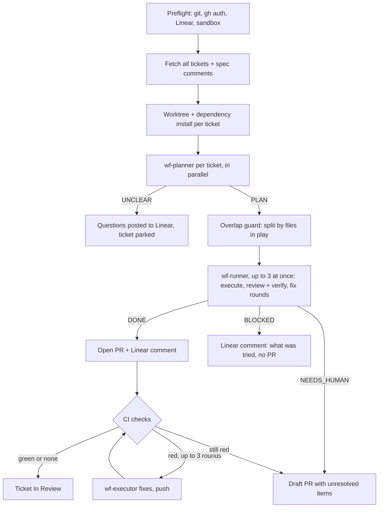

# Ticket Workflow: Framework Overview

Wayfinder takes Linear tickets to GitHub PRs on your machine, hands-off.
Specialized Claude Code subagents plan, implement, verify and review each ticket in its own git worktree.
Then the workflow opens the PR and fixes CI until it is green.

> **Source of truth:** the agent files (`~/.claude/agents/*.md`) and command files (`~/.claude/commands/*.md`) define real behavior.
> This file is an overview. When they disagree, the files win.

## The typical flow

```
/wf ENG-12 ENG-13 ENG-14   # hands-off: each ticket → PR with green CI, In Review
                           # …you review & merge the PRs yourself…
"ENG-12 is merged"         # only now does the workflow clean up (Linear marks it Merged)
```

Two optional extras:

- `/wf-spec <ids>` agrees a spec with you before building. Use it for vague or high-stakes tickets. `/wf` drafts its own definition of done otherwise.
- `/wf-quick <id> <instruction>` applies a small follow-up change to an open PR.

Run `/wf-eval` whenever you change an agent prompt, a model tier, or the flow. It is the regression gate.

## Design choices

### Hands-off by default

A run never stops to ask you anything. When a ticket leaves a decision open, the planner picks the safe, conventional option and records it. Every decision shows up in the PR body and in a comment on the ticket, so a reviewer can overrule it.

The only exception is a ticket with no workable goal at all. Its questions go to Linear as a comment and the ticket is parked (in *Blocked* at Drata). The rest of the batch keeps going. Re-running `/wf <id>` reads the answers and continues.

### Context comes from the repo itself

There is no generated manual and no setup step per repo. The Opus planner reads the repo's own `CLAUDE.md`/`AGENTS.md` (root and nested), `CONTRIBUTING`/`README`, manifests and CI config. It distils them into one dense `CONTEXT_PACK`.

The cheaper downstream agents work from that pack and never re-explore. When the repo's instructions were missing something the planner had to dig for, the run ends with suggested additions to the repo's `CLAUDE.md`. That way the fix lands in the repo where every engineer's agents benefit.

### Local checks are scoped; CI is the finish line

Locally, agents lint, type-check and test only what the change touches. Whole-repo suites and e2e tests are slow on large repos, and CI runs them anyway. After the PR opens, `/wf` watches CI, feeds failures back to the executor, and pushes fixes. A ticket is finished when its PR has green CI.

## Agents (9)

Reasoning agents:

| Agent | Model | Job |
|---|---|---|
| `wf-planner` | opus | Reads the repo's instructions and code, drafts the definition of done, decides open questions, emits the plan + `CONTEXT_PACK` |
| `wf-executor` | sonnet | Implements the plan with atomic commits; also fixes failing CI checks |
| `wf-reviewer` | opus | Reviews the diff coverage-first; flags auth/permissions/customer-data changes for human eyes |
| `wf-verifier` | sonnet | Runs scoped lint/type/test checks and proves each definition-of-done item |
| `wf-spec-builder` | opus | Optional, interactive: turns a thin ticket into a spec with you (`/wf-spec`) |

Boundary agents, each the single owner of one external system:

| Agent | Model | Owns |
|---|---|---|
| `wf-linear` | haiku | All Linear MCP calls |
| `wf-github` | haiku | All `gh` calls, including watching CI and fetching failure logs |

Orchestration and evals:

| Agent | Model | Job |
|---|---|---|
| `wf-runner` | sonnet | One ticket's inner loop: execute → review + verify in parallel → ≤2 fix rounds. Returns `DONE` / `NEEDS_HUMAN` / `BLOCKED` |
| `wf-judge` | sonnet | Eval only: scores an agent's output against a case rubric |

Model tiering is deliberate. Opus goes where reasoning compounds (decisions, architecture, bug-catching). Sonnet executes and verifies. Haiku makes high-volume structured API calls.

## The pipeline



## How each ticket ends

Every ticket in a run ends in exactly one of three states.

**Finished.** The PR is ready for review, CI is green (or the repo has no CI), and the ticket is *In Review*. The PR body lists the decisions made and any areas that need a human look.

**Needs a human.** The PR is a draft (or there is no PR), with the reasons written on it and on the ticket. The ticket stays *In Progress* and the worktree is kept. Re-running `/wf <id>` resumes.

**Parked.** Questions are on the ticket, and the ticket is in *Blocked* (or keeps its state on teams without one). The `🤖 Spec questions` comment, not the state, is what marks it as parked.

## Linear states at Drata

`wf-linear` matches each team's real states by name, then synonyms, then a per-stage fallback. Every Drata engineering team has Triage, Backlog, Todo, In Progress, In Review, Done, Canceled and Duplicate; almost all have Merged, which Linear's GitHub integration sets when the PR merges. No team has a Needs Answers or QA state.

| Workflow step | Drata state |
|---|---|
| Work starts (after planning) | In Progress |
| PR open, CI green | In Review (Code Review on Infrastructure) |
| Ticket parked with questions | Blocked, if the team has it |
| Spec agreed (`/wf-spec`) | Ready for Development where it exists, else Todo |
| PR merged | Merged, set by the GitHub integration |

Two guards keep this safe. `wf-linear` never sets a completed-type state, and it never moves a completed, canceled or duplicate ticket backwards. The QA stage does not match Testing or Ready for Testing, which sit before merge on the teams that have them.

## Operational guarantees

- **Fail-fast preflight.** Nothing is touched until git, `gh`, Linear and the sandbox all check out.
- **Honest status.** A ticket moves to *In Progress* only after it has a plan, and to *In Review* only after CI passes.
- **Resumable.** An existing worktree for the ticket is reused, never recreated or deleted.
- **Bounded loops.** At most 2 review/verify fix rounds and 3 CI fix rounds per ticket. An unrelated CI failure gets one rerun, not code changes.
- **Empty-PR guard.** A branch with no commits beyond base never gets a PR.
- **No stacking.** Each ticket branches from base, so a ticket can't build on another's unmerged work.

## On merge

Only when you say "ENG-123 is merged":

1. `wf-github` confirms the PR is merged.
2. `wf-linear` leaves the ticket in Merged (set by the GitHub integration). It moves to QA only on a team that has a QA state and no automation.
3. The worktree and branch are removed.

A human verifies the result and moves it to Done. The workflow never sets Done.

## Security

The workflow reads untrusted text (tickets, PR history) and runs attacker-influenceable code (tests, install hooks, dependencies). It is built to break the "lethal trifecta": untrusted input, access to secrets, and a way to send data out.

**The `wf-exec` sandbox.** Every project command (install, test, lint, build) runs through `~/.claude/bin/wf-exec`. It strips secret-shaped environment variables and runs the command under a macOS seatbelt profile. The profile blocks all external network egress (loopback still works for local tests). It also blocks reads of credential stores (`~/.ssh`, `~/.aws`, `~/.gnupg`, `gh`/`git` config, `.npmrc`, `.netrc`).

**Offline dependencies.** Because the sandbox has no network, `/wf` installs dependencies offline from your local package cache. A dependency the ticket adds goes into the manifest only; CI installs it.

**The guard hook.** `wf-sandbox-guard.sh` is a `PreToolUse` hook. It blocks unwrapped project commands and raw network tools (`curl`, `wget`, `ssh`, …) inside worktrees. The Opus planner and spec-builder have no WebFetch.

**Single-owner boundaries.** Only `wf-linear` and `wf-github` talk to external systems. A `SubagentStop` hook stops either one from answering without a real tool call.

**Human gates where they matter.** The reviewer flags changes to auth, permissions, tenant scoping, customer data and secrets for human review. Nothing merges without a person.

### Residual edges

These layers raise the cost of an attack. They are not a hermetic boundary: the human PR review before merge is the real backstop.

- **Writes can still carry data out.** Anything a sandboxed process can read, it can write into the worktree, and the PR push carries it out. Add deny entries to the seatbelt template for any other secret locations you use, such as `.env` files or cloud CLI caches.
- **The guard matches on the command string.** It only fires on commands containing `/.worktrees/`, and it treats any command mentioning `wf-exec` as wrapped. The agent instructions cover the gaps.
- **The Keychain is reachable.** The seatbelt profile does not block mach lookups to `securityd`.
- **`wf-github` holds your `gh` token** and posts ticket-derived text. The pre-merge PR review is the control.

## Evals and the regression gate

`/wf-eval` runs stage evals over seed cases in `~/.claude/ticket-workflow-evals/`. Each case is a mock ticket, a tiny dependency-free fixture repo, and a per-stage rubric.

`wf-judge` scores each stage. The runner flags a regression when a case goes from PASS to FAIL or its score drops by more than 0.15 against `baselines/baseline.md`. `/wf-calibrate` checks the judge itself against human labels.

## Firm invariants

- Never merges, never force-pushes, never sets Linear Done.
- Branch `ticket-id/slug`. Worktree `ROOT/.worktrees/<id>`, kept on failure and removed on a confirmed merge.
- All project code runs through `wf-exec`.
- Outward-facing text (PRs, Linear comments) uses repo-relative paths and plain command names, never local paths or agent mechanics.
- Executor commits carry `Co-Authored-By: Claude <noreply@anthropic.com>`. PR bodies end with the `🤖 Generated with Claude Code` footer.
- Ticket-derived text (decisions, spec gaps) goes only to the data log `~/.claude/wf-spec-gaps.md`, never into an agent instruction file.
